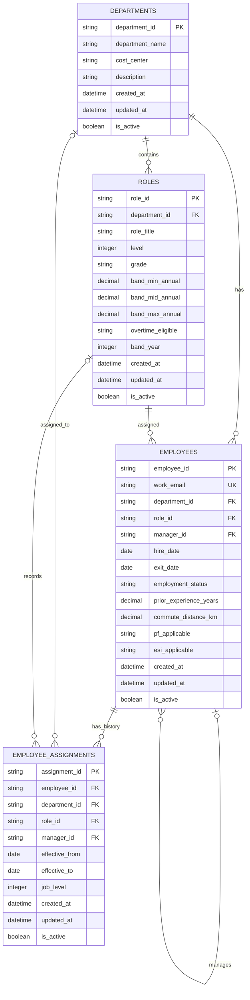

# LedgerForge — Employee Master ER Diagram

## Relationship summary

- One department can have multiple roles and employees.
- An employee can report to another employee through `manager_id`.
- `employee_assignments` stores role and department assignment history.
- `work_email` must be unique.
- An employee's current assignment is intended to have no `effective_to` date.
- `is_active` supports soft deletion instead of physically deleting records.
